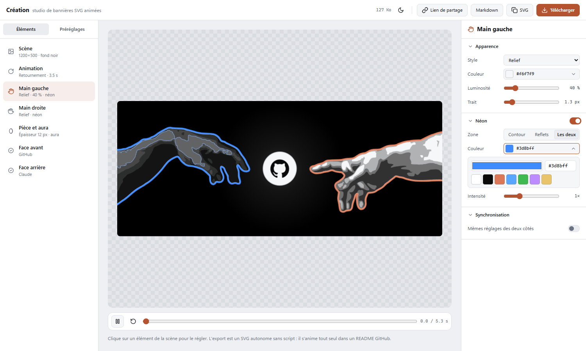
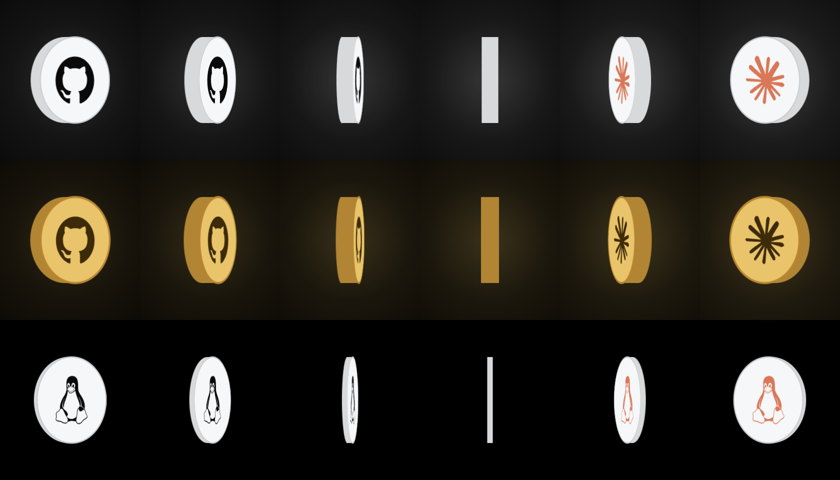

<p align="center"></p>

# Création — studio de bannières SVG animées

Les mains de *La Création d'Adam* (Michel-Ange, domaine public), une pièce qui tourne entre elles, des néons.
Un seul fichier HTML, sans serveur ni compte : on règle, on exporte un **SVG autonome sans script** qui s'anime tout seul dans un README GitHub.

**▶ Ouvrir le studio : <https://tojiisamaa.github.io/studio-creation/>**



## Ce qu'on règle

- **Mains** : style (relief, silhouette, contour), couleur, luminosité, trait, néon (contour, reflets ou les deux).
- **Pièce** : pièce ou logo seul, épaisseur réelle visible au retournement, tranche, liseré, néon, aura.
- **Faces** : un logo par face, recherché parmi les logos [Simple Icons](https://simpleicons.org) (chargés depuis jsDelivr).
- **Animation** : retournement, toupie, lévitation, onde, vitesse.
- **Préréglages** : 7 intégrés, les vôtres (navigateur), export/import `presets.json`, lien de partage.
- **Export** : SVG animé en CSS pur (60 à 150 Ko), `Espace` pour lecture/pause.



## Utiliser le SVG dans un README

```md

```

## Régénérer le studio

`index.html` est produit par `source/assembler-studio.mjs` (injecte mains, logos et gabarit, puis lance un parcours de contrôle avec [Playwright](https://playwright.dev)).
Les mains sont vectorisées depuis la fresque en 14 090 px (`source/decoupe-hd.py`, `source/tracer.mjs`).

## Licence

MIT. Les mains sont tirées d'une œuvre du domaine public (Wikimedia Commons). Les logos de marques restent la propriété de leurs titulaires.
