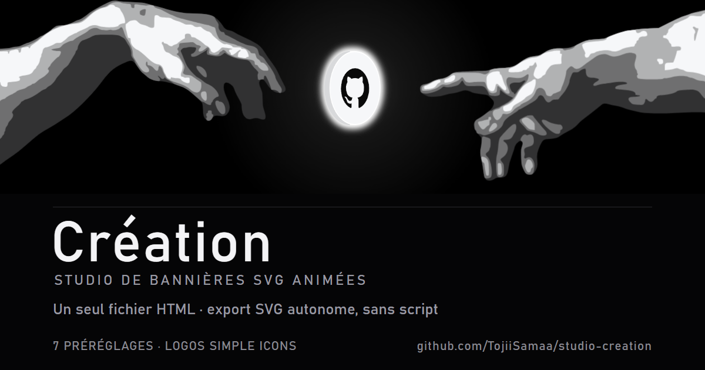

Création est un studio de bannières SVG animées, réalisé avec Claude Code pour Toji : les mains de La Création d'Adam, une pièce qui tourne entre elles, des néons. Tout tient dans un seul fichier HTML, sans serveur ni compte. On règle les mains, la pièce, les logos de ses faces (Simple Icons) et l'animation, puis on exporte un SVG autonome sans script qui s'anime dans un README GitHub.
